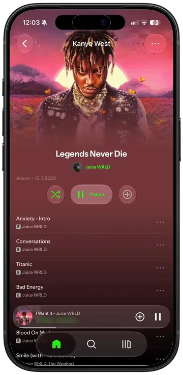
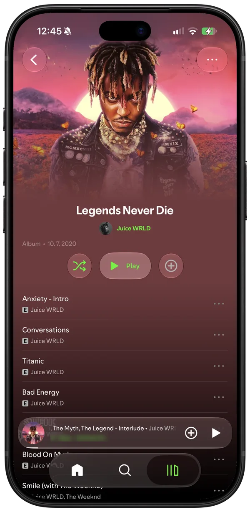
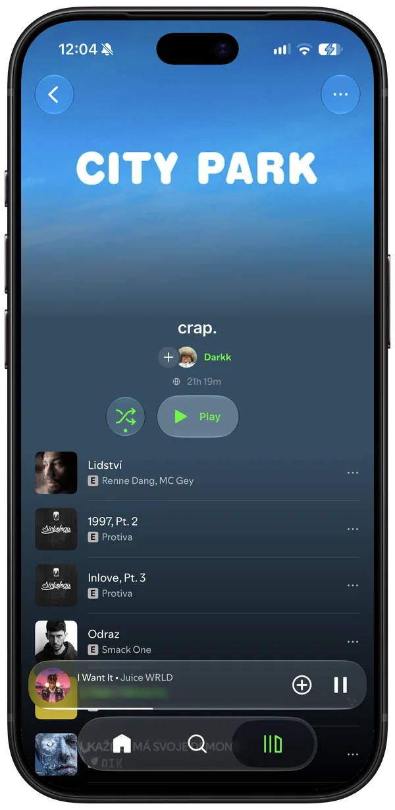
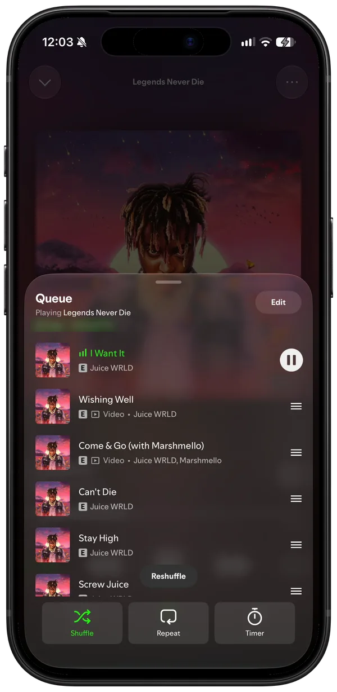
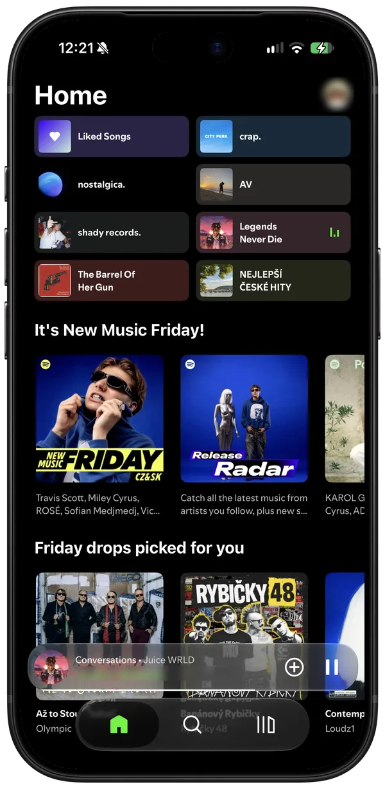

  

<h1 align="center">Sigma</h1>

Spotify, in glass.

  
  
  
  
  
  

  <a href="#build-it">Build it</a> ·
  <a href="docs/tweaks.md">Hack on it</a>

  
  
  
  
  

A no-jailbreak Theos tweak that rebuilds Spotify for iOS in Liquid Glass, injected into your own
decrypted IPA and signed with your own certificate.

Built and tested on **Spotify 9.1.78**, and checked on **9.1.88**. **9.1.90** likely works: it has not been
checked beyond a short run. The mod hooks Spotify's own classes, which change between releases, so any other
version may build and then break.

| | |
|---|---|
| The redesign | **iOS 26+** (untested below) |
| Legacy look | iOS 16.1+ |

The redesign is `UIGlassEffect`, which only exists from iOS 26. Below that the Redesigned UI switch
still works, but it warns first: the redesign falls back to a blur there and has not been tested at
all. Both looks live in Settings → Mod Settings.

## Build it

No IPA is distributed. Bring a decrypted **Spotify 9.1.78** IPA (or 9.1.88, or 9.1.90 at your own risk); you get an unsigned
`Sigma-<mod version>.ipa` to sign with SideStore, Feather or any certificate signer. Each
release also carries the tweak's `.deb`.

### Build with GitHub Actions

Fork the repo, enable Actions, run **Build IPA from your own Spotify IPA**. It takes a direct link to
your decrypted `.ipa` and hands the built IPA back as a workflow artifact. No Mac needed; the link is
masked in the log and the result stays in your fork.

### Build on a Mac

Theos in `~/theos` and Xcode with an iPhoneOS 26+ SDK (`xcode-select` it). An SDK in `~/theos/sdks`
alone builds too. Then:

    brew install make ldid dpkg zsign ideviceinstaller libimobiledevice
    uv tool install "cyan @ git+https://github.com/asdfzxcvbn/pyzule-rw"

Put the decrypted `.ipa` in `ipa/`, then:

    make release    # out/Sigma-<version>.ipa, ready to sign
    make install    # the same, signed with your certificate and pushed over USB

`make install` reads `SIGN_P12`, `SIGN_PROFILE` and `SIGN_P12_PASSWORD` from `.signing.env`; copy
`.signing.env.example` and fill it in.

The first build spends a minute reading Spotify's flags out of your IPA. `make flags` regenerates it.

### Signing

Sign with a bundle id matching your certificate's App ID. If it doesn't match, the app still works
but tapping the player on the lock screen won't open it — and it tells you on first launch which id
to use. In Feather, copy the App ID into **Identifier** and leave **PPQ protection** off; AltStore,
SideStore and Sideloadly get this right on their own.

The app keeps Spotify's bundle id, so it installs over the real Spotify.

## Contributing

Pull requests are welcome. The pull request's description has a box for agreeing to the
[Contributor License Agreement](CLA.md), which gives the project's owner the rights to the
contribution; it is ticked once, before the first pull request is merged.

## Credits

[cyan](https://github.com/asdfzxcvbn/pyzule-rw) injects, [Theos](https://theos.dev) builds, and
[FLEX](https://github.com/FLEXTool/FLEX), as hopeless's AutoFLEX build in `vendor/`, is the inspector
the view trees are read through.

Parts of Sigma come from [Vitrine](https://github.com/My-Name-Is-Jeff/vitrine) by My-Name-Is-Jeff
(GPL-3.0): Sing's voice model and engine, local files, the lyrics' delay, the system Music Haptics,
the volume slider, the landscape player, Home's Top picks, custom fonts, clean links and the What's new
page.

## License

GPL-3.0, see [LICENSE](LICENSE). Not affiliated with Spotify.
